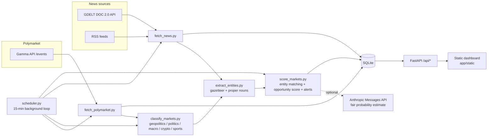

# Polymarket News Terminal

[](https://github.com/gtsmmst/polymarket-news-terminal/actions/workflows/tests.yml)

A small research terminal that watches world news and tries to spot Polymarket
markets whose price has not caught up with the headlines yet. It pulls news
from free sources (GDELT + public RSS), extracts named entities (countries,
leaders, organisations, topics), matches them against the entities found in
active Polymarket markets, and computes a multi-factor **opportunity score**
(0-100) per market. Everything is shown in a three-panel web dashboard:
markets ranked by opportunity, the score breakdown and alerts for the selected
market, and the headlines that were matched to it. An optional LLM hook can add
a fair-probability estimate for the top candidates.

> **Status: experimental prototype.** See [Status](#status) below before relying
> on anything it says.

## Architecture



Pipeline, in order, every 15 minutes (or on demand via **Refresh News + Score**):

1. **fetch_polymarket** pulls active events and their markets from the Gamma
   API and upserts them into SQLite.
2. **classify_markets** labels each market `geopolitics / politics / macro /
   crypto / sports / other` with keyword rules.
3. **extract_entities** derives GDELT search queries from the most frequent
   named entities in the tracked markets; **fetch_news** runs those queries
   plus a set of standing topics against GDELT and pulls a handful of RSS feeds.
   Headlines are deduplicated, tagged with a source tier (1 = wires / quality
   press, 2 = large outlets, 3 = other) and a cheap lexicon sentiment.
4. **score_markets** matches headlines to markets on named-entity overlap and
   computes, per market:

   | factor | meaning |
   |---|---|
   | `news_velocity` | recency-weighted volume of matched headlines |
   | `price_dislocation` | news velocity x (1 - YES price): cheap + busy = interesting |
   | `source_quality` | best source tier among the matches |
   | `sentiment_shift` | recency-weighted net sentiment of the matches |
   | `time_decay` | how convenient the resolution horizon is |
   | `resolution_risk` | penalty for lottery prices, distant horizons, long rules, thin books |
   | `liquidity_score` | whether a reasonably sized position fits |
   | `opportunity_score` | weighted sum of the above, clamped to 0-100 |

   Rule-based alerts (`news_spike`, `news_active`, `tier1`, `risk`) are
   generated from the factors. If `ANTHROPIC_API_KEY` is set, the top ten
   candidates are also sent to the Anthropic Messages API for a fair-probability
   and importance estimate, which is attached as an `ai` alert.

## Running it

Requirements: Python 3.10+.

```bash
git clone https://github.com/gtsmmst/polymarket-news-terminal
cd polymarket-news-terminal

python -m venv .venv
source .venv/bin/activate        # Windows: .venv\Scripts\activate
pip install -r requirements.txt

cp .env.example .env             # optional, see Configuration
uvicorn app.main:app --host 127.0.0.1 --port 8001
```

Then open <http://127.0.0.1:8001>. The first background cycle starts about
eight seconds after boot and takes roughly 30-60 seconds; press
**Refresh News + Score** to run one manually.

`run.sh` (Linux / macOS) and `run.bat` (Windows) do the same steps for you,
including creating the virtualenv.

### Useful endpoints

| method | path | purpose |
|---|---|---|
| `GET` | `/api/health` | liveness |
| `GET` | `/api/event-groups?sort_by=opportunity` | markets grouped by event (what the UI uses) |
| `GET` | `/api/opportunities?limit=50` | top markets by `opportunity_score` |
| `GET` | `/api/alerts` | all active alerts |
| `GET` | `/api/markets/{id}/score` | factor breakdown for one market |
| `GET` | `/api/markets/{id}/headlines` | headlines matched to one market |
| `POST` | `/api/refresh/all` | run one full cycle synchronously |
| `POST` | `/api/refresh/news` | news only |
| `POST` | `/api/refresh/polymarket` | markets only |
| `GET` | `/api/scheduler/status` | last run and its result |
| `POST` | `/api/clear-news` | drop headlines, scores and alerts |

Interactive docs are at `/docs`.

### Tests

```bash
pip install -r requirements-dev.txt
pytest
```

The tests cover the pure scoring functions, entity extraction and an API boot
with the scheduler disabled. They make no network calls.

## Configuration

All settings are environment variables (a `.env` file in the working directory
is picked up automatically). See [`.env.example`](.env.example) for the full
list with defaults. The ones that matter:

| variable | default | notes |
|---|---|---|
| `DATABASE_PATH` | `data/app.db` | SQLite file; directory is created on start |
| `POLYMARKET_BASE_URL` | `https://gamma-api.polymarket.com` | Gamma API root |
| `SCHEDULER_ENABLED` | `1` | set `0` to disable the background loop |
| `SCHEDULER_INTERVAL_SEC` | `900` | cycle length |
| `ANTHROPIC_API_KEY` | unset | enables the LLM fair-probability hook |
| `AI_MODEL` | `claude-haiku-5-5` | Messages API model id for the hook |

## Status

This is an **experimental prototype that has never been validated live**.

- The pipeline has been syntax-checked, unit-tested on synthetic data and
  booted in a test client, but it has **not** been run end-to-end against the
  live GDELT, RSS and Polymarket endpoints. Expect some feeds or endpoints to
  need adjusting (the Gamma `/events/keyset` call falls back to `/events`, but
  neither has been exercised from this code).
- News-to-market matching is a keyword heuristic over a small gazetteer. It
  produces *candidates*, not conclusions, and the score weights are hand-picked
  rather than calibrated against outcomes.
- The score has no notion of market history, so it cannot tell a genuine
  mispricing from a market that has already moved.
- Nothing here places trades or is financial advice.

The code was written with AI assistance (Claude) and reviewed by hand.

## Roadmap

- Run the pipeline live, fix whatever the real feeds break, and record a
  sample run.
- Store score history so the "news velocity vs. price" delta can be measured
  over time instead of as a snapshot.
- Compare 6-hour news velocity against a baseline to flag genuine *spikes*.
- Push alerts above a score threshold to Telegram.
- Replace the gazetteer with a proper NER model and add fuzzy matching.
- Calibrate the factor weights against resolved markets.

## License

MIT, see [LICENSE](LICENSE).
